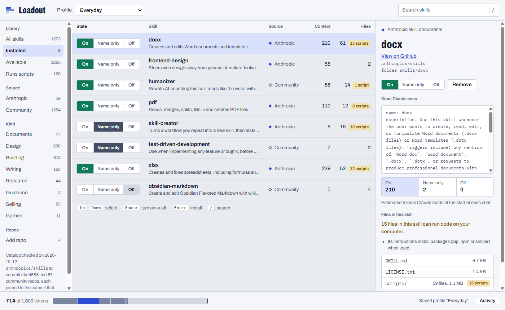
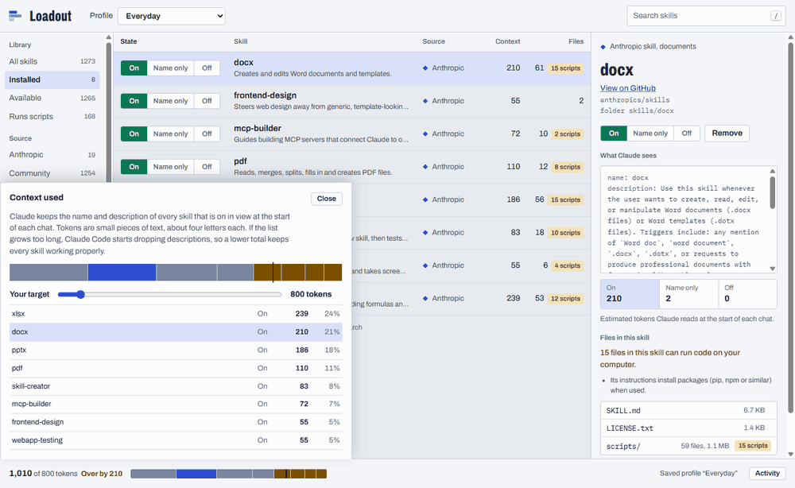
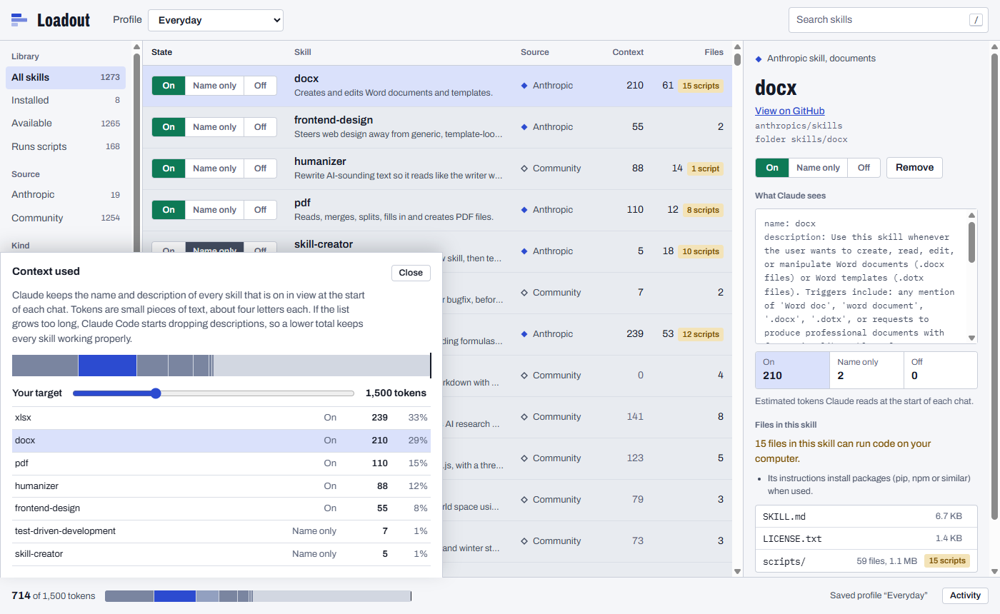

# Loadout

A mod manager for [Claude Code](https://code.claude.com) skills, for Windows.

Pick skills from a checked catalog, install each with one click, and switch it **On**, **Name only** or
**Off** without touching a file. A meter shows how much of Claude's context your skills take up before
you type anything.



**[Download for Windows](https://github.com/NeekBot5000/loadout/releases/latest)** · [How the catalog is checked](docs/catalog-audit.md) · [Design notes](DESIGN.md)

## Why

Every skill that is on puts its name and description in front of Claude at the start of each chat.
Install a few dozen and Claude Code starts dropping descriptions to fit, and you cannot see which ones.
Loadout makes that visible and lets you dial each skill down:

| State | What Claude sees | Cost |
| --- | --- | --- |
| On | Name and full description | All of it |
| Name only | Just the name; the skill still works when you call it | A few tokens |
| Off | Nothing | None |



It writes this to `skillOverrides` in `~/.claude/settings.json`, Claude Code's own setting for it
(Claude Code 2.1.129 or newer), so nothing is moved or renamed. Claude Code's built-in `/skills` menu
can switch states too; Loadout adds the catalog, installs, profiles, the cost of each skill up front,
and a safety review. More in [How Claude Code loads skills](site/src/guide-context.html).

## What it does

- **Catalog.** 1,273 skills: Anthropic's [`anthropics/skills`](https://github.com/anthropics/skills) and
  57 community repos, each pinned to the exact commit that was checked.
- **One-click install** into `~/.claude/skills`, with real progress, and **Remove** moves a skill to
  `.trash` instead of deleting it.
- **Profiles.** Save a setup ("Writing", "Client work") and switch in one step. Applying a profile is a
  single settings write.
- **Your own skills** already in `~/.claude/skills` show up as "Yours". You can switch them; Loadout never
  removes or overwrites a folder it did not create.
- **Add any GitHub repo.** Loadout downloads it, reads every file, and shows the whole `SKILL.md` and what
  its safety check flags before anything is added.
- **Updates** with a file-by-file diff before you accept them. The old copy goes to `.trash`.
- Keyboard first: Up and Down, Space to toggle, Enter to install, `/` to search. Light and dark.

## Safety

Skills are instructions Claude follows, and some include scripts that can run on your computer.
So Loadout:

- never runs anything from a skill; it only copies files,
- refuses archives with links, `..` paths or oversized files, and installs with a single rename so a
  failed install leaves nothing half-written,
- downloads only from `github.com` and `codeload.github.com`,
- lists every script in a skill before you install it.

The community catalog was built by downloading 160 popular skill repos and reading every file in every
skill against rules for prompt injection, hidden text, reading secrets, sending data out, running code
from the internet and more. Every high-risk hit in an included repo was read by a person. Ten repos were
left out, each with the reason, in [docs/catalog-audit.md](docs/catalog-audit.md). That check covers one
commit per repo; it is not a guarantee.



## Install

Download `Loadout-Setup-<version>.exe` from [Releases](https://github.com/NeekBot5000/loadout/releases/latest)
and run it. It installs for your user only and adds Start Menu and desktop shortcuts. The installer is
not code-signed yet, so Windows SmartScreen may warn; choose **More info**, then **Run anyway**.
Loadout updates itself from this repo's releases.

## Files it touches

| Path | What Loadout does |
| --- | --- |
| `~/.claude/skills/<name>/` | Installs skill folders. Never touches folders it did not create, `synced/` or `.trash/` contents. |
| `~/.claude/settings.json` | Edits only `skillOverrides`, in one atomic write, keeping a backup at `settings.json.loadout-backup`. |
| `~/.loadout/` | Its own state (install receipts with file hashes, profiles, repos you added), download cache, activity log and `logs/`. |

## Build from source

Node 22 or newer. In Windows PowerShell use `npm.cmd`, since script execution blocks `npm.ps1`.

```
npm install
npm run dev        # Vite + Electron with live reload
npm test           # install engine tests
npm run dist       # Windows installer in dist/
```

More checks: `python -I scripts/e2e.py` drives the built app against a throwaway home folder;
`python -I scripts/slop_check.py <url>` scores a screen against measured AI-design tells
([why](docs/design-research.md)).

Pushing a `v*` tag builds the installer on GitHub Actions and publishes the release.

## Layout

- `engine/` install engine, settings editor, profiles, safety review (plain Node, tested)
- `src/main/` Electron main process: everything that touches disk or network
- `src/preload/` the typed `window.loadout` API, nothing else
- `src/renderer/` the interface
- `catalog/` the checked catalog; `tools/catalog-audit/` rebuilds it
- `site/` the website (`node site/build.mjs` builds `site/dist`); launch notes in [docs/launch.md](docs/launch.md)

## License

MIT. Loadout is an independent project and is not affiliated with or endorsed by Anthropic.
"Claude" and "Claude Code" are trademarks of Anthropic. Skills in the catalog belong to their authors
and keep their own licenses.
